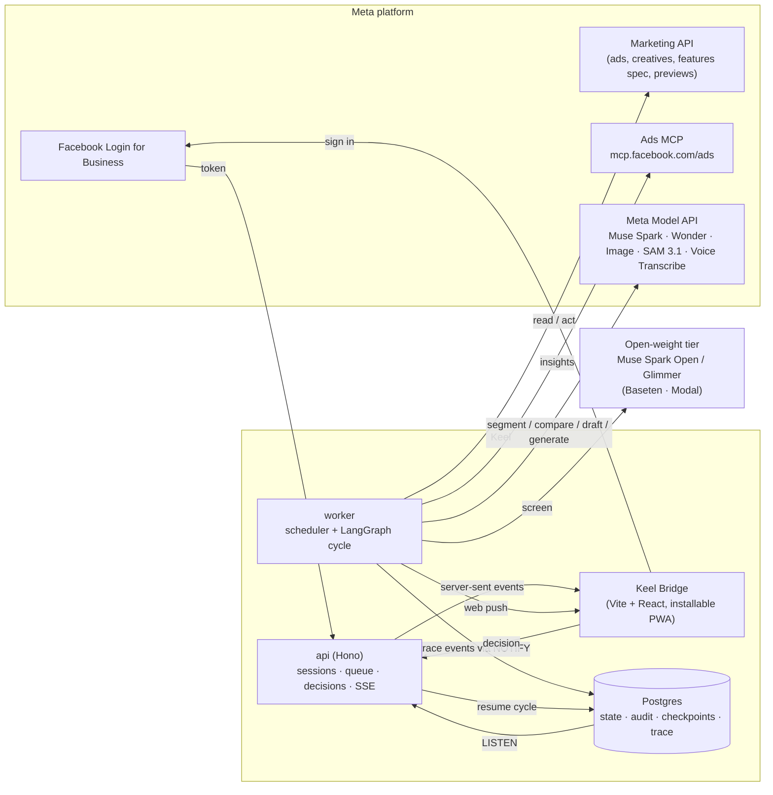
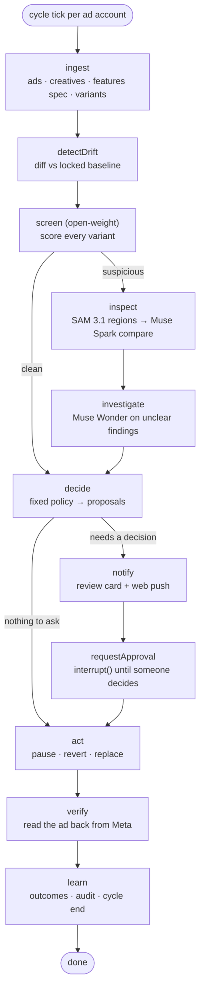

# Keel — Architecture

Keel is a **deterministic agent spine with model judgment at the edges**. The cycle is a fixed LangGraph graph so every run is reproducible and auditable; models are called only where judgment is needed; every action that touches a live ad passes a policy gate, a human decision in **Keel Bridge**, and a read-back from Meta.

## 1. System overview



## 2. The watch cycle (LangGraph)



| Node | Kind | Model | Output |
|---|---|---|---|
| `ingest` | deterministic | — | `AdSnapshot[]`; first sight of a creative locks its baseline |
| `detectDrift` | deterministic | — | `SETTING_DRIFT` findings |
| `screen` | model | Muse Spark Open / Glimmer | per-variant score + suspected codes |
| `inspect` | model + vision | SAM 3.1 → Muse Spark | findings with regions, evidence, confidence |
| `investigate` | agent (tool loop) | Muse Wonder | resolves findings with confidence 0.45–0.75 |
| `decide` | deterministic | — | proposals, persisted with their findings |
| `notify` | side effect | — | review card + push to owners and reviewers |
| `requestApproval` | human | — | `interrupt()`; resumed by the decision endpoint |
| `act` | deterministic | Muse Image (replace only) | Marketing API mutations |
| `verify` | deterministic | — | confirms the new state, or flags a mismatch |
| `learn` | deterministic | — | proposal outcomes, audit, cycle completed |

`notify` is its own node because LangGraph re-runs a node from the top when it resumes: side effects placed before `interrupt()` would fire twice.

Every node runs inside an `AsyncLocalStorage` context carrying the cycle and node, so model clients deep in the call stack report into the live trace without threading ids through every function.

**Why a fixed graph:** the work is a known pipeline; letting a model choose the order adds failure modes without adding capability. The one open-ended step, an unclear finding, gets a bounded tool-using sub-agent.

## 3. Model routing

| Task | Model | Why |
|---|---|---|
| Fast screen of every variant | **Muse Spark Open** (Baseten `meta-models/muse-spark-open-1026`) or **Muse Glimmer** (Modal) | Cheap, high volume; qualifies for the open-weight bonus |
| Region isolation | **SAM 3.1** (`sam-3.1`, Responses API) | Concept prompts ("person", "product", "price text") give comparable regions |
| Region comparison + reasons | **Muse Spark** | Multimodal reasoning, structured output |
| Rulebook drafting, investigation | **Muse Wonder** (`muse-wonder-1.0`) | 1M context, strongest agentic model on the API |
| On-brand replacement | **Muse Image** | Up to 10 reference images, accurate in-image text |
| Voice commands (stretch) | **Muse Voice Transcribe** (realtime WebSocket) | Browser mic streams PCM16 directly |

All text and vision calls go through OpenAI-compatible clients (`https://api.meta.ai/v1`, Bearer `META_API_KEY`). Each call reports model, latency, tokens and cost to the trace.

## 4. Keel Bridge (web app)

| Screen | Data |
|---|---|
| Review | `GET /api/queue`, `POST /api/proposals/:id/decision` |
| Live trace | `GET /api/cycles`, `GET /api/cycles/:id/trace`, SSE |
| Accounts + lock board | `GET /api/accounts`, `GET /api/accounts/:id/ads`, `POST /api/accounts/:id/cycles` |
| Audit log | `GET /api/audit` (chain verified server-side on every load) |
| Connect an account | `GET /api/meta/adaccounts`, `POST /api/accounts`, `POST /api/rulebooks/draft` |

**Live updates.** The worker writes each trace event to `trace_events` and publishes it with Postgres `NOTIFY`. Each API process holds one `LISTEN` connection and fans events out over server-sent events to every open browser that can see that account. The browser patches the trace in place and refreshes the queue.

**Alerts.** `notify` sends web push (VAPID) to owners and reviewers of the account; the service worker shows the alert and opens the review card when tapped. Expired subscriptions are deleted.

**Demo workspace.** A seeded fictional brand (Northline) lets judges try every screen. Decisions there are simulated: recorded, audited and streamed, but no Meta call is made. `POST /api/demo/reset` restores it.

## 5. Access and approvals

| Role | Can |
|---|---|
| owner | everything, including pausing ads and shipping replacements |
| reviewer | reject anything; approve log, relock and revert |
| viewer | watch |

Rules live in `canDecide()` in `@keel/core`. A decision is accepted only if the proposal is pending, unexpired, the user's role allows it, and the cycle is still paused at `requestApproval`. The proposal is claimed atomically (`pending → deciding`) so a double click can't resume a cycle twice.

| Action | Meta API effect |
|---|---|
| `LOG` | none |
| `RELOCK_SETTING` | new creative with the enhancement `OPT_OUT`, swap the ad's creative |
| `PAUSE_AD` | `status=PAUSED`, then read back |
| `REVERT_CREATIVE` | new creative from the approved original, enhancements opted out, swap |
| `REPLACE_CREATIVE` | Muse Image variant → second decision on the image → new creative → swap |

The Ad Creative Features Spec endpoint is read-only and creatives are treated as immutable, so every change is a new creative plus an ad update.

## 6. Data model (Postgres)

| Group | Tables |
|---|---|
| People and access | `users`, `workspaces`, `memberships` (role), `sessions`, `meta_connections` (token AES-GCM encrypted), `push_subscriptions` |
| Brands | `brands`, `ad_accounts`, `rulebooks` |
| Watch cycle | `cycles`, `snapshots`, `creative_baselines`, `findings`, `proposals`, `approvals`, `trace_events` |
| Trust | `audit_log` (hash-chained), `eval_runs` |
| LangGraph | checkpoint tables from `@langchain/langgraph-checkpoint-postgres`; thread id = cycle id |

The audit log is **hash-chained** (`hash = sha256(prev_hash ‖ actor, event, payload)`), verified on every audit page load.

## 7. Variant sources (pluggable)

- `MetaPreviewSource`: Marketing API ad previews per placement (HTML; rendering to images is M2).
- `FixtureVariantSource`: local or uploaded variants for the eval set and as the demo fallback.

## 8. Repo layout

```
keel/
├─ apps/
│  ├─ api/        Hono: auth, sessions, routes, SSE hub
│  ├─ worker/     scheduler + cycle runner
│  └─ web/        Keel Bridge
├─ packages/
│  ├─ core/       schemas, defects, policy, roles   (+ tests/)
│  ├─ agents/     graph, judges, rulebook, runtime, push, trace context   (+ tests/)
│  ├─ meta/       Model API, open-weight, SAM, Marketing API, Ads MCP, variants, voice
│  └─ db/         schema, migrations, audit, crypto, events, demo seed   (+ tests/)
├─ eval/          labelled variant pairs + runner
├─ scripts/       local Postgres, demo seed
└─ docs/
```

## 9. Stack

| Layer | Choice | Reason |
|---|---|---|
| Language | TypeScript, Node 22, npm workspaces | One language end to end |
| Agent runtime | LangGraph.js + Postgres checkpointer | `interrupt()` for decisions, resumable cycles |
| API | Hono (node-server, SSE, cookies, CSRF) | Small, fast |
| DB | Postgres + Drizzle; `embedded-postgres` for local dev | No Docker needed |
| Web | Vite, React 19, TanStack Router + Query, Tailwind 4 | Fast to build, typed routes |
| Push | `web-push` (VAPID) + service worker | Phone alerts without an app store |
| Model clients | `openai` SDK against Meta Model API and Baseten | Both OpenAI-compatible |
| MCP | `@modelcontextprotocol/sdk` | Ads MCP insights |
| Tests | Vitest | Unit + eval harness |
| Deploy | API + worker on Cloud Run or Railway; web on Vercel; Postgres on Neon | Familiar, quick |

## 10. Security

- Facebook Login for Business with a `state` cookie; long-lived token stored AES-256-GCM encrypted (`KEEL_SECRET`).
- Sessions: random id in a signed, HttpOnly, SameSite=Lax cookie; server-side expiry.
- Every state-changing request must come from an allowed Origin; Hono CSRF middleware on top.
- Media endpoint serves only from `eval/fixtures` and `.data/media`.
- No action without a decision unless the brand opts into a specific auto-action.
- Dev sign-in only when `DEV_AUTH=1`; the demo workspace cannot start real checks.

## 11. Day-1 verification checklist

- [ ] Meta Model API key works; confirm IDs for Muse Spark, Muse Wonder, Muse Image, SAM 3.1.
- [ ] SAM 3.1 request/response shape (Responses API, mask format).
- [ ] Baseten `meta-models/muse-spark-open-1026` call with an image.
- [ ] Meta app: Facebook Login for Business configuration with `ads_read`, `ads_management`, `business_management`; app in development mode with you as admin.
- [ ] Marketing API on a test ad account: list ads, read `degrees_of_freedom_spec`.
- [ ] Ad previews: do AI-enhanced variants render? (ask in #office-hours)
- [ ] VAPID keys generated; push arrives on your phone from the installed app.
- [ ] Ads MCP: connect, call `ads_insights_anomaly_signal`.
