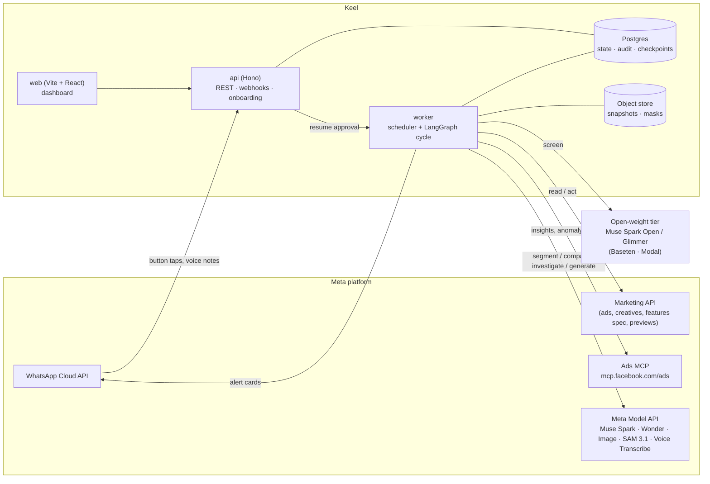
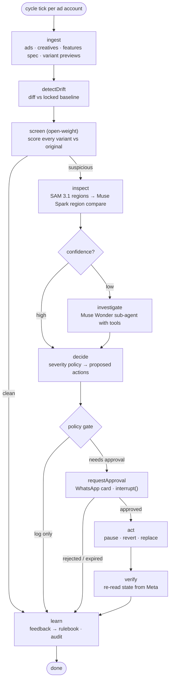

# Keel — Architecture

Keel is a **deterministic agent spine with model judgment at the edges**. The cycle is a fixed LangGraph graph so every run is reproducible and auditable; models are called only where judgment is needed; every action that touches a live ad passes a policy gate, a human approval and a post-action verification.

## 1. System overview



## 2. The watch cycle (LangGraph)



| Node | Kind | Model | Output |
|---|---|---|---|
| `ingest` | deterministic | — | `AdSnapshot[]` (ad, creative, features spec, variant images) |
| `detectDrift` | deterministic | — | `Finding[]` with code `SETTING_DRIFT` |
| `screen` | model | Muse Spark Open / Glimmer | per-variant `screenScore` (0–1) + suspected defect codes |
| `inspect` | model + vision | SAM 3.1 → Muse Spark | `Finding[]` with regions, evidence, confidence |
| `investigate` | agent (tool loop) | Muse Wonder | resolves ambiguous findings using tools |
| `decide` | deterministic policy | — | `ActionProposal[]` |
| `requestApproval` | human | — (Voice Transcribe for voice replies) | approval / rejection via `interrupt()` |
| `act` | deterministic | Muse Image (replace only) | Marketing API mutations |
| `verify` | deterministic | — | confirmed post-state or rollback alert |
| `learn` | deterministic + model | Muse Wonder | rulebook updates, audit entries |

**Why a fixed graph and not a free-roaming supervisor:** the work is a known pipeline; letting a model choose the order adds failure modes without adding capability. The one open-ended step — an ambiguous finding — gets a bounded tool-using sub-agent with a step limit.

### Investigator tools (`investigate`)

`getOriginalCreative`, `getCatalogItem`, `segment(concept)`, `compareRegions`, `getRulebook`, `getAdInsights`, `getAnomalySignal` (Ads MCP), `searchPastFindings`. Max 8 steps; must end with a structured verdict.

## 3. Model routing

| Task | Model | Why |
|---|---|---|
| Fast screen of every variant | **Muse Spark Open** (Baseten `meta-models/muse-spark-open-1026`) or **Muse Glimmer** (Modal) | Cheap, high-volume; qualifies for the open-weight bonus |
| Region isolation | **SAM 3.1** (`sam-3.1`, Responses API) | Concept prompts ("person", "shoe", "price text") give comparable crops |
| Region comparison + reasons | **Muse Spark** (`muse-spark-1.x`) | Multimodal reasoning, structured output |
| Rulebook drafting, investigation | **Muse Wonder** (`muse-wonder-1.0`) | 1M context, strongest agentic model on the API |
| On-brand replacement | **Muse Image** | Up to 10 reference images, accurate in-image text |
| Voice-note approvals, voiceover audit | **Muse Voice Transcribe** (`muse-voice-transcribe-1.0`, realtime WebSocket) | 25 languages incl. Tamil and Hindi |

All text/vision models are called through OpenAI-compatible clients (`https://api.meta.ai/v1`, Bearer `META_API_KEY`). Model IDs live in config and are verified on day 1.

## 4. Data model (Postgres)

| Table | Key fields |
|---|---|
| `brands` | id, name, whatsapp_number, policy (auto-actions allowed) |
| `ad_accounts` | id, brand_id, meta_account_id, token_ref, poll_interval_min |
| `rulebooks` | brand_id, version, rules (JSON), source_ads, created_by |
| `creative_baselines` | creative_id, approved_image_hash, features_spec (JSON), locked_at, locked_by |
| `snapshots` | id, cycle_id, ad_id, creative_id, features_spec, variant refs |
| `findings` | id, cycle_id, ad_id, variant_ref, code, severity, confidence, regions, evidence, status |
| `proposals` | id, finding_id, action, params, requires_approval, status, expires_at |
| `approvals` | id, proposal_id, channel, decided_by, decision, decided_at, raw (button / transcript) |
| `audit_log` | seq, at, actor, event, payload, prev_hash, hash |
| `eval_runs` | id, model_tier, precision, recall, cost_per_variant, created_at |
| LangGraph checkpoints | managed by `@langchain/langgraph-checkpoint-postgres` |

The audit log is **hash-chained** (`hash = sha256(prev_hash ‖ event)`), so any tampering breaks the chain — cheap, and it makes "verifiable agent" concrete.

## 5. Actions and the approval contract

| Action | Meta API effect | Approval |
|---|---|---|
| `LOG` | none | none |
| `RELOCK_SETTING` | new creative with enhancement `OPT_OUT`, swap ad's creative | required unless brand policy allows auto-relock |
| `PAUSE_AD` | `status=PAUSED` | required |
| `REVERT_CREATIVE` | new creative from approved original, enhancements opted out, swap | required |
| `REPLACE_CREATIVE` | Muse Image variant → new creative → swap | required twice (action, then the generated image) |

Every proposal carries: target, action, reason, evidence (image refs + regions), expected spend impact, expiry (default 6 h). Approvals arrive as WhatsApp button replies carrying a signed proposal token (HMAC, single use). After `act`, `verify` re-reads the ad from Meta and confirms the new state; a mismatch raises a high-severity alert instead of retrying silently.

Note: the Ad Creative Features Spec endpoint is read-only, and creatives are treated as immutable — every "change" is a new creative plus an ad update.

## 6. Variant sources (pluggable)

```ts
interface VariantSource {
  listVariants(ad: AdRef): Promise<Variant[]>; // rendered images of what Meta may serve
}
```

- `MetaPreviewSource` — Marketing API ad previews per placement.
- `FixtureVariantSource` — local or uploaded variants (eval set, demo fallback, brand exports).

## 7. Repo layout

```
keel/
├─ apps/
│  ├─ api/        Hono server: REST, WhatsApp webhook, onboarding
│  ├─ worker/     scheduler + LangGraph cycle runner
│  └─ web/        Vite + React dashboard
├─ packages/
│  ├─ core/       zod schemas: findings, rulebook, proposals, defect codes, policy
│  ├─ agents/     LangGraph graph, nodes, prompts, investigator tools
│  ├─ meta/       clients: Model API, open-weight, SAM, Ads Graph, Ads MCP, WhatsApp, Voice
│  └─ db/         Drizzle schema, migrations, hash-chained audit log
├─ eval/          labelled variant pairs + runner (precision/recall, cost per variant)
└─ docs/          IDEATION.md, ARCHITECTURE.md
```

## 8. Stack

| Layer | Choice | Reason |
|---|---|---|
| Language | TypeScript, Node 22, npm workspaces | One language end to end |
| Agent runtime | LangGraph.js + Postgres checkpointer | `interrupt()` for approvals, resumable cycles |
| API | Hono | Small, fast, runs anywhere |
| DB | Postgres (Neon) + Drizzle | Relational audit + checkpoints in one place |
| Objects | S3-compatible (Cloudflare R2), local FS in dev | Variant images and masks |
| Web | Vite + React + Tailwind | Fast dashboard |
| Model clients | `openai` SDK against Meta Model API and Baseten | Both are OpenAI-compatible |
| MCP | `@modelcontextprotocol/sdk` client | Ads MCP insights and anomaly signal |
| Media | ffmpeg | Voice-note OGG → PCM16; video frames |
| Tests | Vitest | Unit + eval harness |
| Deploy | API + worker on Cloud Run or Railway; web on Vercel | Familiar, quick |

## 9. Security

- Meta access via system-user token scoped to chosen ad accounts; tokens referenced by ID, stored in a secrets manager.
- Ads MCP connections use Meta's own OAuth; start read-only.
- WhatsApp webhook signature (`X-Hub-Signature-256`) verified; proposal tokens HMAC-signed and single use.
- No action without approval unless the brand opted into a specific auto-action.
- Zero-data-retention requested on the Model API where offered.

## 10. Day-1 verification checklist

- [ ] Meta Model API key works; confirm exact IDs for Muse Spark, Muse Wonder, Muse Image, SAM 3.1.
- [ ] SAM 3.1 request/response shape (Responses API, mask format).
- [ ] Baseten `meta-models/muse-spark-open-1026` call with image input.
- [ ] Marketing API sandbox account: list ads, read `creative_features_spec` / `degrees_of_freedom_spec`.
- [ ] Ad previews endpoint: do AI-enhanced variants render? (ask in #office-hours)
- [ ] WhatsApp Cloud API test number: send an interactive button message, receive the reply webhook.
- [ ] Ads MCP: connect, call `ads_insights_anomaly_signal`.
